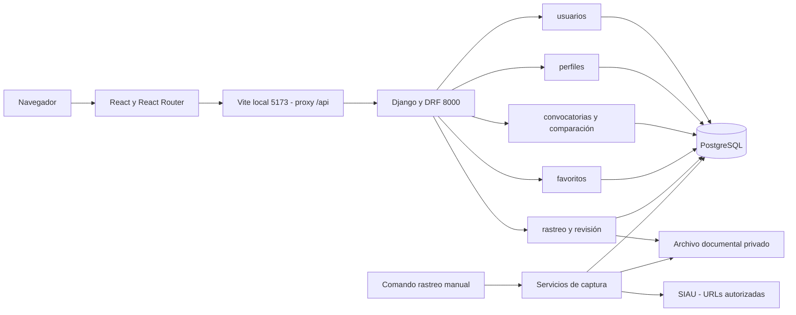
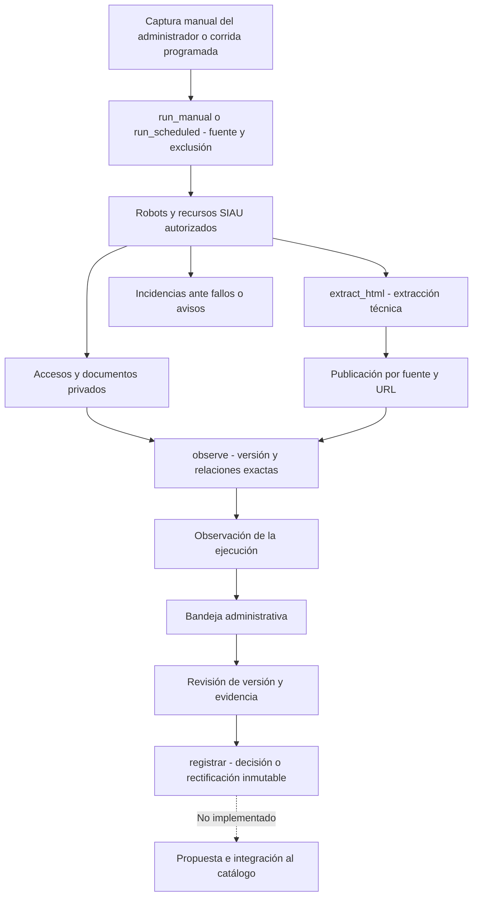
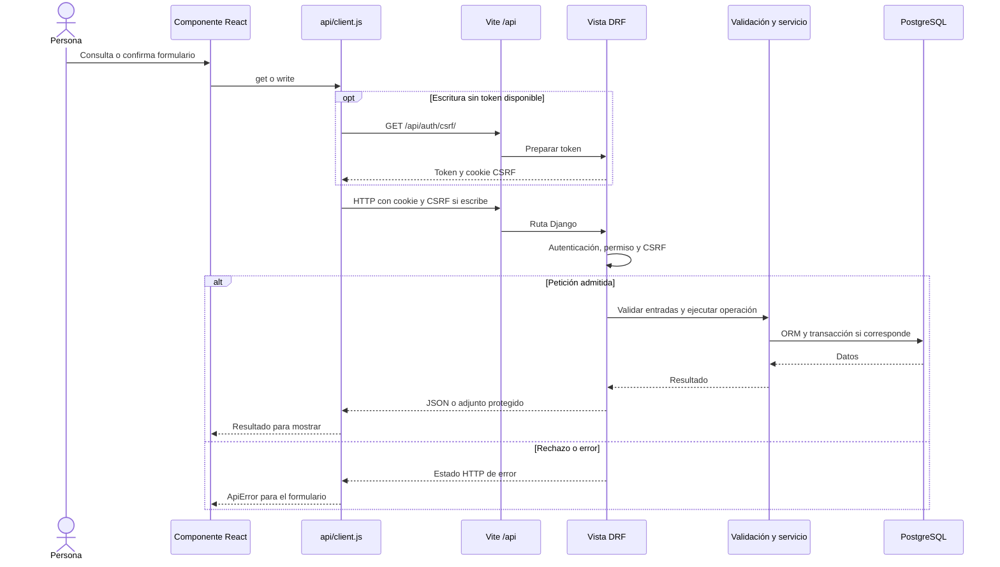

# Guía de arquitectura de BecaNexo

## 1. Introducción y objetivo

Esta guía explica la implementación existente para estudiar, mantener y defender técnicamente BecaNexo. Se elaboró mediante lectura del repositorio el 29/10/2026, tomando como referencia el commit `3925b671775df4f75481cbf103cac52ba5af663b`. No es una propuesta de refactorización.

BecaNexo permite consultar becas de entidades ecuatorianas, declarar información académica, guardar favoritas y comparar requisitos explícitos. La postulación, la verificación de certificados y la adjudicación corresponden a la entidad oferente. Los roles de negocio son postulante y administrador.

**Alcance de esta comprobación:** lectura de código, configuración pública, migraciones y documentación; sin ejecutar Django, pruebas, consultas PostgreSQL, rastreos ni escrituras de negocio. Las migraciones aplicadas y los resultados de pruebas citados desde [CIERRE_ETAPA_1.md](CIERRE_ETAPA_1.md) son evidencia histórica, no mediciones repetidas aquí. No se leyó `.env`.

Las rutas de código indicadas son relativas a la raíz del repositorio. La guía distingue tres planos: lo que implementa el código, lo que documenta el cierre anterior y lo que sigue pendiente.

## 2. Tecnologías utilizadas

| Capa | Declaración comprobada | Uso |
| --- | --- | --- |
| Backend | `backend/requirements.in`: Django `>=5.2,<5.3`, DRF `>=3.16,<3.17` | ORM, autenticación, sesiones, administración y API JSON |
| Dependencias fijadas del backend | `backend/requirements.txt`: Django `5.2.18`, DRF `3.16.1`, psycopg/psycopg-binary `3.3.6`, django-environ `0.12.1` | Instalación reproducible conforme a ese archivo; no se comprobó el entorno instalado |
| Base de datos | PostgreSQL, mediante `django.db.backends.postgresql` y psycopg | Persistencia relacional, restricciones, transacciones, bloqueos y triggers |
| Configuración | django-environ | Lectura de variables privadas; `.env.example` documenta nombres sin secretos |
| Frontend | `frontend/package.json`: React/React DOM `^19.0.0`, React Router DOM `^7.0.0` | SPA, componentes y rutas |
| Desarrollo y estilos | Vite `^8.0.0`, Tailwind CSS y plugin Vite `^4.0.0`; CSS propio | Servidor local, compilación y presentación |
| Recursos locales | lucide-react `^1.63.0`, @fontsource/inter `^5.3.0` | Iconos y tipografía empaquetados, sin CDN |
| Verificación | Vitest, Testing Library, jsdom, ESLint y Playwright | Pruebas de componentes, navegador y análisis estático |
| Runtime frontend | `engines.node: >=24 <25` | Node 24; ruta local documentada `D:\Herramientas\node-v24.22.1-win-x64` |

`package.json` contiene rangos y algunas dependencias de desarrollo declaradas como `latest`; `package-lock.json` registra la resolución concreta. Declaraciones, resolución del lock e instalación efectiva son conceptos distintos. No se ejecutaron consultas de versiones instaladas. Tampoco se deduce una versión del servidor PostgreSQL a partir de psycopg.

## 3. Arquitectura general

El backend es un **monolito modular**: cinco aplicaciones Django comparten configuración, base PostgreSQL y proceso servidor. Las aplicaciones separan responsabilidades, pero no son microservicios: importan modelos, permisos y utilidades entre sí. React es una SPA separada que consume la API mediante peticiones relativas a `/api/`.

En desarrollo, `frontend/vite.config.js` sirve `127.0.0.1:5173` y redirige `/api` a Django en `127.0.0.1:8000`. El navegador conserva un origen para la aplicación; el proxy mantiene el encabezado Origin. Esto no equivale a habilitar CORS indiscriminadamente ni define un despliegue de producción.



El comando de captura no lo dispara el catálogo ni la bandeja administrativa. El acceso a archivos documentales pasa por una vista protegida; no son recursos públicos de Vite.

## 4. Árbol de directorios

Árbol selectivo: omite archivos secundarios y contenido privado.

```text
BecaNexo/
├── AGENTS.md                      reglas de trabajo
├── backend/
│   ├── manage.py                  entrada de comandos Django
│   ├── requirements.in / requirements.txt
│   ├── .env.example               plantilla pública; .env privado, no versionable
│   ├── config/                    settings, urls, wsgi, asgi
│   ├── usuarios/                  cuenta, API, manager, admin, pruebas, migraciones
│   ├── perfiles/                  perfil, relaciones, catálogos, comandos y pruebas
│   ├── convocatorias/             catálogo, administración, reglas, comparación
│   │   ├── siau_red.py            acceso de red controlado
│   │   ├── siau_extraccion.py     interpretación técnica del HTML
│   │   └── siau_bases.py          notas documentales manuales identificadas
│   ├── favoritos/                 relación personal usuario-convocatoria
│   └── rastreo/                   persistencia, consulta y revisión administrativa
│       ├── management/commands/rastreo.py
│       ├── models.py / services.py / observaciones.py / storage.py
│       ├── api.py / urls.py / revisiones.py
│       └── migrations/            0001 a 0007 y protecciones PostgreSQL
├── frontend/
│   ├── package.json / package-lock.json
│   ├── vite.config.js / playwright*.config.js
│   ├── src/
│   │   ├── main.jsx / App.jsx / styles.css
│   │   ├── api/client.js
│   │   ├── auth/                  contexto, proveedor y retorno seguro
│   │   ├── pages/                 pantallas y auxiliares de presentación
│   │   ├── components/            formularios, layouts, comparación, revisiones
│   │   ├── test/setup.js          configuración exclusiva de Vitest
│   │   └── *.test.jsx             pruebas de interfaz
│   └── e2e/                       pruebas Playwright y preparadores auxiliares
├── docs/
│   ├── Modelo/                    modelos históricos y suplementos
│   ├── diseno/                    referencias de interfaces
│   └── *.md                       contratos, decisiones, operación y avances
└── outputs/rastreo/               resultados y auxiliares locales ignorados
```

`.venv/` y `frontend/node_modules/` son dependencias instaladas, no código propio. `frontend/dist/`, `test-results/` y reportes son generados. `outputs/rastreo/` conserva evidencias de vistas previas y verificaciones locales: su presencia no convierte sus scripts en servicios de ejecución habitual. La captura persistente entra por `manage.py rastreo`, no por esos auxiliares.

El archivo documental se configura fuera del repositorio; la ubicación documentada es `D:\Datos_BecaNexo\rastreo`. Los respaldos conjuntos documentados están bajo `D:\Respaldos_BecaNexo`. No se inspeccionaron ni alteraron estos directorios en esta tarea. Los archivos HTML/PDF constituyen evidencia, no módulos ejecutables.

## 5. Backend Django

`backend/manage.py` selecciona `config.settings` para comandos. `backend/config/wsgi.py` y `asgi.py` exponen la aplicación a servidores compatibles. `settings.py` reúne aplicaciones, middleware, PostgreSQL, autenticación y cookies; `config/urls.py` distribuye solicitudes.

### Aplicaciones propias: cinco

| App | Responsabilidad y símbolos de entrada | Dependencias relevantes |
| --- | --- | --- |
| `usuarios` | `Usuario`, manager personalizado; `AuthView`, `RegistroView`, `LoginView`, `MeView`, `LogoutView` | Autenticación y permisos Django; base común de las API |
| `perfiles` | `PerfilView`, `RelacionView`, `CatalogosView`, `EsPostulante`; perfil, formación, experiencia e idiomas | Usuario y catálogos propios |
| `convocatorias` | `Consulta`, `Convocatorias`, `Hijos`, `Accion`, `Comparacion`; servicios de publicación y comparación | Instituciones, catálogos de perfiles, usuario y favoritos |
| `favoritos` | `Lista`, `Quitar`, `Favorito` | Propietario autenticado y visibilidad pública de convocatorias |
| `rastreo` | `Publicaciones`, `VersionDetalle`, `Revisiones`; servicios técnicos y revisión editorial | Usuario administrador; adaptador SIAU ubicado en convocatorias |

Además se registran DRF y las aplicaciones contribuidas de Django para admin, auth, contenttypes, sessions, messages y staticfiles; no se cuentan como aplicaciones propias.

Las API son clases DRF, organizadas en `api.py`, no una arquitectura basada obligatoriamente en viewsets. Los serializers convierten/validan entradas y salidas; las restricciones de modelos y migraciones refuerzan invariantes en PostgreSQL. Los servicios separan operaciones complejas, aunque algunas transacciones de escritura permanecen en las vistas.

### Autenticación y autorización

`usuarios/models.py` implementa `Usuario(AbstractBaseUser, PermissionsMixin)` con correo como `USERNAME_FIELD`, sin username. Su manager normaliza espacios exteriores y mayúsculas; `get_by_natural_key` aplica esa política al backend `ModelBackend`. La contraseña se guarda con mecanismos de Django, nunca como texto claro. La unicidad del correo se refuerza con una restricción sobre `Lower(Trim(email))`.

`CSRFSesionAuthentication` en `usuarios/api.py` comprueba CSRF también en solicitudes anónimas. Registro y login no dependen únicamente del comportamiento estándar de `SessionAuthentication`. `AuthView` aplica `never_cache`, JSON y esa autenticación; cada vista define sus permisos. Registro crea un postulante sin inicio de sesión automático. Login devuelve un token CSRF renovado y el usuario seguro. Los casos de correo inexistente, contraseña errónea o cuenta inactiva comparten un error genérico.

La cookie de sesión es HttpOnly y SameSite=Lax; Secure es configurable para HTTPS. No se usa JWT ni localStorage para credenciales. El token CSRF del cliente permanece en memoria. Los límites de login/registro emplean caché local en proceso; no son una protección distribuida. `usuarios/throttles.py` y las variables `AUTH_*` de settings definen esta política.

El rol de negocio no equivale a `is_staff`: este último habilita acceso al admin de Django. `EsPostulante` protege perfil/favoritos/comparación; `Administrador` protege gestión de convocatorias; `AdministradorActivo` protege rastreo. El backend obtiene al propietario/actor de la sesión, no de un usuario destino enviado por el navegador. Ocultar enlaces en React mejora navegación, pero no sustituye estos permisos.

### Endpoints principales

Se muestran métodos de negocio; se omite OPTIONS. `{id}` representa el entero de la URL, no texto literal.

| Ruta | Método y finalidad | Acceso |
| --- | --- | --- |
| `/api/auth/csrf/` | GET, preparar CSRF | Público |
| `/api/auth/registro/`, `/api/auth/login/` | POST, cuenta/sesión | Público con CSRF y límites |
| `/api/auth/me/` | GET usuario mínimo; PATCH solo nombre visible | Autenticado |
| `/api/auth/logout/` | POST, invalidar sesión | Autenticado y CSRF |
| `/api/perfil/` | GET, PATCH perfil propio | Postulante |
| `/api/perfil/catalogos/` | GET catálogos | Autenticado |
| `/api/perfil/{recurso}/` y `/{id}/` | GET/POST colección; GET/PATCH/DELETE elemento | Postulante propietario |
| `/api/becas/catalogos/`, `/api/becas/`, `/api/becas/{id}/` | GET catálogos, lista y detalle público | Incluye anónimo |
| `/api/becas/{id}/comparacion/` | GET evaluación actual | Postulante |
| `/api/favoritos/`, `/api/favoritos/{id}/` | GET/POST lista; DELETE favorito | Postulante propietario |
| `/api/gestion/instituciones/`, `/{id}/` | GET/POST colección; GET/PATCH detalle | Administrador |
| `/api/gestion/convocatorias/`, `/{id}/` | GET/POST colección; GET/PATCH detalle | Administrador |
| `/api/gestion/convocatorias/{id}/publicar/`, `/pausar/` | POST acción | Administrador |
| `/api/gestion/convocatorias/{id}/auditoria/` | GET historial | Administrador |
| `/api/gestion/convocatorias/{id}/{recurso}/`, `/{hijo}/` | GET/POST colección; GET/PATCH/DELETE elemento | Administrador |

En perfiles, `{recurso}` es `formaciones`, `experiencias`, `idiomas`, `areas`, `preferencias` o `destinos` (`perfiles/api.py`, `RECURSOS`). En gestión de convocatorias es `opciones`, `beneficios` o `requisitos` (`convocatorias/api.py`, `RECURSOS`). Véanse sus `urls.py` para la composición exacta.

## 6. Frontend React

`frontend/src/main.jsx` monta `StrictMode → BrowserRouter → AuthProvider → App`, importa CSS e Inter local. `App.jsx` resuelve sesión y rutas; `auth/context.js` expone `useAuth`. `AuthProvider.jsx` restaura sesión mediante `/me/`, diferencia carga, anónimo y error, y actualiza el nombre en memoria después de una respuesta satisfactoria.

Para estudiar el frontend se distinguen **siete áreas funcionales**, no siete paquetes independientes: bienvenida/Inicio; autenticación/cuenta; perfil/preferencias; catálogo/detalle/comparación; favoritos; administración de convocatorias/oferentes; rastreo/revisión. `src/pages/` contiene doce archivos de página JSX, además de auxiliares JS y CSS; algunos colaboran en una misma área.

| Rutas React | Componentes y comportamiento |
| --- | --- |
| `/` | `Welcome`, presentación pública |
| `/login`, `/registro` | `Login`, `Register`, `AuthLayout` |
| `/inicio` | `Home`, protegido; accesos según rol |
| `/perfil`, `/preferencias` | `Profile`, variante de datos académicos o preferencias; solo postulante |
| `/becas`, `/becas/:id` | `Offers`/`PublicCatalog`, `OfferDetail`; consulta pública |
| `/favoritos` | `Favorites`; solo postulante |
| `/gestion/convocatorias`, `/gestion/convocatorias/nueva`, `/gestion/convocatorias/:id` | `Offers` administrativo y `OfferEditor` |
| `/gestion/instituciones` | `Institutions` |
| `/gestion/rastreo/*` | `Crawling`, rutas internas de publicaciones y ejecuciones |

`ProfileLayout` concentra barra lateral, navegación por rol, edición del nombre y cierre de sesión. `OffersLayout` lo reutiliza cuando hay sesión y proporciona encabezado público si no la hay. `EditName` mantiene el nombre de cuenta separado de los nombres del perfil académico. `Button`, `Icon`, `Message`, `Field` y formularios especializados comparten presentación y accesibilidad. La iconografía es local y decorativa cuando acompaña texto.

`api/client.js` centraliza `request`, `prepareCsrf`, `authApi`, `profileApi` y `offersApi`. Envía cookies same-origin y no-store, prepara CSRF antes de escrituras y transforma errores HTTP/red en `ApiError`. Diferencia 403, 429 y errores del servidor; no presenta HTML de error como contenido de la aplicación. Cada formulario mantiene sus estados y errores, no asume que una petición tuvo éxito.

`CatalogFilters`, `CatalogCard`, `FavoriteButton` y `Comparison` componen la consulta. Un visitante que intenta guardar una beca pasa al login con retorno seguro; no se guarda automáticamente. `auth/returnPath.js` admite únicamente `/becas` o `/becas/<entero positivo>` sin parámetros ni fragmentos; otros destinos vuelven a `/inicio`.

`src/test/setup.js` configura Vitest y limpia montajes/mocks después de cada prueba. No lo importa `main.jsx` y no conecta la aplicación normal a una API simulada. Las interceptaciones de Playwright pertenecen a los archivos de prueba.

## 7. Base de datos PostgreSQL

`config/settings.py` utiliza variables `DB_NAME`, `DB_USER`, `DB_PASSWORD`, `DB_HOST` y `DB_PORT`. La plantilla pública distingue desarrollo `becanexo_db` y `DATABASES['default']['TEST']['NAME'] = 'test_becanexo_db'`; no hay TEST.MIRROR. Los valores privados efectivos no se inspeccionaron. Django utiliza ORM y migraciones; rastreo emplea también SQL PostgreSQL explícito para bloqueos y garantías históricas.

| Dominio | Tablas y relaciones principales |
| --- | --- |
| Cuenta | `MAE_USUARIO`; password → columna `password_hash`, is_active → `activo`; nombre visible independiente del perfil |
| Perfil | `MAE_PERFIL` uno a uno con usuario; `MAE_FORMACION`, `MAE_EXPERIENCIA`; `REL_PERFIL_IDIOMA`, `REL_PERFIL_AREA`, `CFG_PREFERENCIA`, `REL_PERFIL_PAIS` |
| Catálogos | `CAT_PAIS`, `CAT_IDIOMA`, `CAT_AREA`, `CAT_TIPO_BECA`, `CAT_TIPO_REQUISITO` |
| Ofertas | `MAE_INSTITUCION` vinculada a país; `MAE_CONVOCATORIA` a institución/tipo; `MAE_OPCION_ESTUDIO` a convocatoria y países mediante `REL_OPCION_ESTUDIO_PAIS`; `REL_CONVOCATORIA_AREA` |
| Condiciones | `MAE_BENEFICIO` y `MAE_REQUISITO`, comunes o ligados a una opción de la misma convocatoria; requisitos pueden delimitar destino |
| Historial de negocio | `AUD_EVENTO`, actor real y convocatoria o institución |
| Favoritos | `REL_FAVORITO`, usuario + convocatoria únicos y fecha de creación |
| Rastreo | Diez tablas descritas en la sección 8, separadas de las ofertas publicables |

Las reglas incluyen validez de roles, correo único normalizado, escalas de promedio coherentes y relaciones entre hijos y su convocatoria. Los JSON estructurados de requisitos se validan mediante contratos (`convocatorias/reglas.py`); JSON no significa ausencia de esquema ni código ejecutable.

No todas las relaciones tienen la misma regla de borrado: el perfil y sus datos propios utilizan relaciones CASCADE donde corresponde; referencias a catálogos usan PROTECT. El historial de rastreo tiene protecciones más estrictas. Hay que leer `on_delete`, constraints y SQL de migraciones antes de diseñar cambios.

Las tablas técnicas de Django no están representadas íntegramente por el ER de negocio: sesiones (`django_session`), migraciones (`django_migrations`), tipos de contenido, permisos/grupos, relaciones de permisos de usuario y registros del admin. `last_login`, `is_staff`, `is_superuser` y relaciones heredadas de `PermissionsMixin` completan el modelo de cuenta para Django.

`docs/Modelo/Modelo_logico_v06.json` conserva el modelo base y v05 el histórico. Los suplementos `Ampliacion_comparacion_v06.md`, `Persistencia_rastreo_bloque1.md`, `Persistencia_rastreo_bloque2.md` y `Revision_administrativa_rastreo.md` explican ampliaciones. Un nombre presente en el ER no demuestra que exista un modelo Django.

En código hay migraciones iniciales de usuarios, perfiles y favoritos; convocatorias añade a su inicial `0002_requisito_destino_requisito_equivalencias_and_more.py`. Rastreo contiene `0001_initial`, `0002_integridad_historial`, `0003_publicaciones_versiones`, `0004_integridad_versiones`, `0005_coherencia_observaciones`, `0006_revision_editorial` y `0007_integridad_revision_editorial`. Las últimas amplían revisión sin reescribir decisiones anteriores. El cierre documenta su aplicación; aquí se comprobó la existencia de archivos, no su estado en PostgreSQL.

## 8. Rastreo y revisión administrativa

### Captura técnica y almacenamiento

`rastreo/management/commands/rastreo.py` ofrece configurar, activar/desactivar, ejecutar, resumir, recuperar e inspeccionar evidencia. `services.run_manual` comprueba administrador, clave idempotente, fuente activa y contrato SIAU cerrado. Usa exclusión por fuente/origen, registra ejecuciones omitidas cuando corresponde y mantiene recuperables las interrupciones duras. No existe un planificador diario implementado.

`PersistentDownloader` reutiliza `convocatorias/siau_red.py`: URLs admitidas, comprobaciones de red, robots y límites. Las marcas de inicio distinguen admisión del intento de comienzo de la operación HTTP; el limitador local utiliza reloj monotónico. `siau_extraccion.extract_html` conserva texto y contexto, incluidas menciones académicas compuestas; no convierte automáticamente una mención en una opción de catálogo. `siau_bases.py` contiene notas manuales identificadas, no un motor universal de extracción PDF ni aprobación de documentos.

`storage.prepare_document`, `register_document` y `verify_file` separan archivo físico y registro: huella SHA-256, tamaño, ubicación privada y comprobación de integridad. `observaciones.identity` usa fuente + URL normalizada, sin fusionar por título. `observe` bloquea la publicación, confirma versión y relaciones documentales en transacción y registra la observación de cada ejecución. Distingue cambios de bytes y contenido relevante; un extractor distinto puede producir una versión distinta con los mismos documentos.

| Modelo en `rastreo/models.py` | Tabla | Papel y relación |
| --- | --- | --- |
| `Fuente` | `CFG_FUENTE` | Política de acceso; activa no equivale a aprobada para publicación automática |
| `Ejecucion` | `TRA_EJECUCION_RASTREO` | Invocación, fuente, actor manual, clave, estado y contadores |
| `Documento` | `TEC_DOCUMENTO_RASTREO` | Bytes identificados por hash, tamaño y clave privada |
| `Acceso` | `TRA_ACCESO_RASTREO` | Intento HTTP de una ejecución, resultado y documento si existe |
| `Incidencia` | `TRA_INCIDENCIA_RASTREO` | Aviso/error técnico con contexto, sin usuarios ni convocatorias ficticios |
| `Publicacion` | `TRA_PUBLICACION_FUENTE` | Identidad por fuente/URL; no obliga a crear convocatoria |
| `Version` | `TRA_VERSION_PUBLICACION` | Interpretación inmutable, manifiesto, hashes y versión de extractor |
| `VersionDocumento` | `REL_VERSION_DOCUMENTO` | Evidencia exacta y rol documental de una versión |
| `Observacion` | `TRA_OBSERVACION_RASTREO` | Ejecución + publicación, con versión observada o fallo |
| `Revision` | `AUD_REVISION_RASTREO` | Acción humana histórica, evidencia, dimensión y eventual rectificación |

Las migraciones de integridad añaden restricciones y triggers: la protección no depende solo de que un formulario omita editar. Una observación posterior A→B→A puede reutilizar A; por eso la versión predeterminada de consulta procede de la última observación exitosa, no del mayor número de versión. Número de versión dentro de una publicación e ID global son distintos.

### API y bandeja

Todos estos endpoints parten de `/api/gestion/rastreo/`, requieren administrador activo y aplican no-store:

| Sufijo | Métodos | Vista |
| --- | --- | --- |
| `fuentes/` | GET | `Fuentes` |
| `publicaciones/`, `publicaciones/{id}/` | GET | `Publicaciones` |
| `publicaciones/{id}/versiones/` | GET | `Versiones` |
| `publicaciones/{id}/versiones/{version_id}/` | GET | `VersionDetalle` |
| `publicaciones/{id}/versiones/{version_id}/documentos/` | GET | `DocumentosVersion` |
| `publicaciones/{id}/observaciones/` | GET | `Observaciones` |
| `ejecuciones/`, `ejecuciones/{id}/` | GET | `Ejecuciones` |
| `ejecuciones/{id}/accesos/`, `ejecuciones/{id}/incidencias/` | GET | `Accesos`, `Incidencias` |
| `documentos/{id}/descarga/` | GET | `Descargar` |
| `publicaciones/{id}/versiones/{version_id}/revisiones/` | GET, POST | `Revisiones` |

`Crawling.jsx` permite `/gestion/rastreo`, `/gestion/rastreo/publicaciones/:id`, `/gestion/rastreo/ejecuciones` y `/gestion/rastreo/ejecuciones/:id`. Presenta listados paginados, filtros, selección de versión, documentos y errores/reintentos. La descarga usa respuesta como adjunto, tipo no ejecutable, nosniff y CSP; no publica la ruta física ni ejecuta HTML. Una ejecución antigua sin publicaciones puede consultarse sin reconstruir retrospectivamente su historial.

### Decisiones humanas

`CrawlingReviews.jsx` presenta formulario e historial; `RevisionEntrada` valida campos, justificación y evidencia. Extracción revisa la versión completa; documentación y oferente exigen una relación `VersionDocumento` perteneciente a esa versión. Para aprobar oferente solo se acepta entidad ecuatoriana con referencia; convenio y no determinado no pueden aprobarse mediante esta etapa.

`revisiones.registrar` obtiene el actor de la vista autenticada, comprueba administrador activo bajo bloqueo, serializa claves de acción y bloquea la versión. Mismo UUID y contenido recuperan la fila previa; contenido diferente o predecesor obsoleto producen conflicto 409. `sustituye_id` identifica la decisión vigente que se rectifica: la rectificación inserta otra fila, no modifica la anterior. `vigentes` excluye decisiones sustituidas; documental se distingue por evidencia. No se hereda una aprobación a una versión/PDF nuevo.

**Implementación disponible no equivale a revisión sustantiva realizada.** El cierre de etapa registra cero revisiones editoriales reales y dos revisiones históricas de configuración. Ese dato es histórico, no un recuento consultado hoy. Captura, descarga correcta, revisión de extracción, admisibilidad del oferente, documentación, publicación y vigencia son conceptos distintos. Una oferta cerrada no es rechazada y un 404 no cancela una convocatoria.



## 9. Motor de recomendaciones y estado real

Existe **comparación explicable por reglas**, en `convocatorias/comparacion.py`; no un motor semántico de afinidad. `evaluar_convocatoria` consulta el perfil actual y opciones activas, compone requisitos comunes/de opción/de destino y utiliza `evaluar_alternativa`, `evaluar_requisito` y `agregar`. Devuelve `cumple`, `no_cumple` o `desconocido`, datos declarados y explicaciones. Una opción destacada surge de esos resultados; no es un ranking semántico.

Los grupos de misma formación no mezclan el área de un título con el promedio de otro. La formación candidata debe satisfacer conjuntamente las condiciones. Hay listas explícitas de niveles admitidos, equivalencias revisadas (`equivalencias.py`), contexto territorial y alternativas de destino. Los documentos permanecen sujetos a comprobación externa aunque coincidan datos declarados.

Los promedios de escalas distintas no se convierten sin una fórmula aprobada. Experiencia puede procesar intervalos y superposiciones, pero no inventa la equivalencia a meses pendiente de definición. Información insuficiente conserva incertidumbre; no se convierte automáticamente en incumplimiento. Una respuesta se calcula con datos actuales y no-store; no se persiste una recomendación artificial.

No se identifican modelos de embeddings, biblioteca de similitud semántica, cálculo de afinidad ponderada ni API de IA en este flujo. `TRA_RECOMENDACION` y `TRA_EVALUACION_REQUISITO` del diseño no constituyen modelos persistidos por esta implementación. Los pesos futuros 70/10/10/10 de [decisiones-recomendacion-rastreo.md](decisiones-recomendacion-rastreo.md) son decisiones para otra etapa, no porcentajes calculados hoy.

## 10. Flujos de funcionamiento

### A. Inicio de sesión

1. `Login` usa el contexto; `authApi.login` obtiene CSRF y envía email/password a `/api/auth/login/`.
2. `LoginView` valida con `LoginSerializer`, llama a `authenticate` y a `django.contrib.auth.login`.
3. Django consulta `MAE_USUARIO` y administra sesión mediante sus mecanismos nativos; responde usuario mínimo y CSRF renovado.
4. `AuthProvider` actualiza estado. `loginReturnPath` selecciona retorno permitido o `/inicio`. Al recargar, `/me/` restaura el usuario desde la sesión.

### B. Consulta de becas y favoritos

1. `Offers`/`PublicCatalog` solicita catálogos y lista mediante `offersApi`; filtros cambian parámetros y paginación.
2. `Consulta` aplica `services.publicas`: convocatoria activa, revisión validada e institución ecuatoriana. Borradores/pausadas no aparecen ni por ID.
3. `filtrar` combina nivel/modalidad/destino sobre la misma opción. `detalle(..., publico=True)` elimina información administrativa.
4. `OfferDetail` presenta beneficios, condiciones y enlace oficial. `FavoriteButton` escribe solo para postulante autenticado; `Lista` usa request.user y unicidad para evitar duplicados.
5. Si la oferta deja de ser pública, favoritos devuelve aviso sin datos ocultos y permite quitar la relación propia.

La visibilidad pública no excluye automáticamente toda oferta cerrada: `publicas` controla publicación; el estado temporal puede filtrarse. No debe documentarse un filtro predeterminado de abiertas que el código no aplica.

### C. Perfil académico

1. `Profile` carga perfil/catálogos y recursos mediante `profileApi`.
2. GET `/api/perfil/` devuelve perfil o null, sin crear uno por lectura. PATCH crea/actualiza el perfil propio con validación.
3. `RelacionView` gestiona formación, experiencia, idiomas y preferencias bajo el perfil del usuario; no permite escoger otro propietario.
4. Las escrituras bloquean/actualizan versión del perfil. La comparación posterior utiliza estos datos actuales. Editar el nombre de cuenta no sincroniza automáticamente el perfil.

### D. Rastreo y extracción

El iniciador es el comando `rastreo ejecutar`, no un endpoint React. `run_manual` registra la ejecución y `PersistentDownloader` descarga únicamente el contrato permitido; robots comparte el limitador. HTML se interpreta con `extract_html`; las bases descargadas siguen pendientes de revisión. Se conservan procedencia y expresiones originales, sin crear opciones de estudio.

### E. Persistencia de evidencia

El servicio prepara/verifica archivos, registra `Documento` y `Acceso`, identifica `Publicacion` y llama a `observe`. El manifiesto reúne documentos exactos; se crea o reutiliza `Version`, se insertan `VersionDocumento` y una `Observacion` por publicación/ejecución. Si no hay contenido válido, se conserva fallo/incidencia sin fabricar versión. Las ejecuciones sin cambios siguen existiendo.

### F. Revisión administrativa

`Crawling` consulta la última observación exitosa y permite seleccionar versiones históricas. `CrawlingReviews` consulta revisiones y envía POST con dimensión, motivo, evidencia, predecesor y clave de acción. `Revisiones` comprueba permisos/CSRF y llama a `registrar(request.user.pk, ...)`. La respuesta refleja la fila real creada o reutilizada; conflictos requieren revisar historial. No hay escritura en convocatorias ni aprobación derivada de una mera descarga.

### G. Comparación disponible

El postulante pulsa comparar/actualizar en `Comparison`. GET `/api/becas/{id}/comparacion/` valida acceso público a la oferta y obtiene perfil desde request.user. `evaluar_convocatoria` devuelve resultados por opción/destino y explicaciones; React separa coincidencias, pendientes e incompatibilidades. No escribe `TRA_RECOMENDACION`, no usa preferencias como prueba de elegibilidad y no asigna una probabilidad de adjudicación.



El diagrama es general: descargas se manejan como archivos y no por el lector JSON común; no toda consulta necesita un servicio separado ni una transacción de escritura.

## 11. Archivos fundamentales

Orden sugerido de estudio: **15 archivos**. Los colaboradores citados permiten seguir cada función sin pretender que todo el sistema quepa en esta selección.

| Orden y archivo | Responsabilidad, símbolos y relaciones | Momento y utilidad para estudiar |
| --- | --- | --- |
| 1. [settings.py](../backend/config/settings.py) | `INSTALLED_APPS`, `DATABASES`, `AUTH_USER_MODEL`, middleware; conecta entorno y apps | Al iniciar Django; establece límites globales y seguridad |
| 2. [urls.py principal](../backend/config/urls.py) | `urlpatterns`, incluye urls de cinco apps y admin | Al resolver HTTP; mapa inicial del backend |
| 3. [main.jsx](../frontend/src/main.jsx) | `createRoot`, BrowserRouter, AuthProvider y App | Arranque del navegador; muestra composición raíz |
| 4. [App.jsx](../frontend/src/App.jsx) | `App`, rutas y selección según sesión/rol | En navegación; permite seguir pantallas y guardas |
| 5. [client.js](../frontend/src/api/client.js) | `request`, `prepareCsrf`, `ApiError`, authApi/profileApi/offersApi | En cada operación de API; conecta UI, cookies y errores |
| 6. [AuthProvider.jsx](../frontend/src/auth/AuthProvider.jsx) | `restore`, `AuthProvider`, login/logout/updateName; usa client y context | Al montar y cambiar sesión; explica actualización global sin recarga |
| 7. [models.py de usuarios](../backend/usuarios/models.py) | `Usuario`, campos, manager y restricciones; colabora con managers.py | Al autenticar/persistir cuentas; distingue identidad y rol de permisos técnicos |
| 8. [api.py de usuarios](../backend/usuarios/api.py) | `AuthView`, `CSRFSesionAuthentication`, vistas de cuenta; serializers y throttles | En auth y como base reutilizada; esencial para CSRF anónimo y no-store |
| 9. [api.py de perfiles](../backend/perfiles/api.py) | `PerfilView`, `RelacionView`, `EsPostulante`, `escritura`; modelos y serializers | En consulta/escritura propia; muestra control de propietario y versión |
| 10. [services.py de convocatorias](../backend/convocatorias/services.py) | `publicas`, `detalle`, `publicar`, `touch`; usados desde api.py | Al consultar/publicar/editar; concentra visibilidad y reglas del catálogo |
| 11. [comparacion.py](../backend/convocatorias/comparacion.py) | `evaluar_convocatoria`, `evaluar_alternativa`, `evaluar_requisito`, `agregar` | Al pedir comparación; explica resultados sin IA ni mezcla de formaciones |
| 12. [models.py de rastreo](../backend/rastreo/models.py) | Diez modelos de evidencia e historial; complementados por migraciones | En persistencia y consulta; distingue documento, versión y observación |
| 13. [services.py de rastreo](../backend/rastreo/services.py) | `run_manual`, `PersistentDownloader`, `configure`, `recover`; llama storage y observaciones | En comandos operativos; muestra red fuera de transacciones largas y recuperación |
| 14. [revisiones.py](../backend/rastreo/revisiones.py) | `RevisionEntrada`, `registrar`, `vigentes`, `ConflictoRevision`; modelos/API | Al confirmar decisiones; explica idempotencia, evidencia exacta y rectificaciones |
| 15. [CrawlingReviews.jsx](../frontend/src/components/CrawlingReviews.jsx) | `CrawlingReviews`; colabora con Crawling y offersApi | Al consultar/guardar revisiones; conecta historial y conflictos con la experiencia humana |

Para profundizar, seguir `rastreo/observaciones.py` → `storage.py` → `api.py`; para catálogo, `convocatorias/models.py` → `serializers.py` → `reglas.py` → `api.py`. Favoritos queda concentrado en `favoritos/api.py` y `FavoriteButton.jsx`; no requiere inventar una capa de servicios que no existe.

## 12. Cómo ejecutar y probar el proyecto

**Comandos de referencia, no ejecutados en esta tarea.** PowerShell desde la raíz `D:\Proyectos\BecaNexo`. La preparación instala archivos en el entorno local; no es necesaria para leer esta guía. En el entorno existente se reutilizan `.venv` y configuración privada, sin reemplazarlos.

```powershell
# Preparación de dependencias de un entorno que lo necesite
.\.venv\Scripts\python.exe -m pip install -r backend\requirements.txt
$env:PATH = 'D:\Herramientas\node-v24.22.1-win-x64;' + $env:PATH
npm.cmd --prefix frontend ci

# Terminal del backend
.\.venv\Scripts\python.exe backend\manage.py runserver 127.0.0.1:8000

# Otra terminal, con Node 24 en PATH
npm.cmd --prefix frontend run dev
```

En una máquina nueva debe existir previamente un entorno virtual Python compatible, PostgreSQL preparado y configuración basada en `.env.example`. No se incluyen credenciales ni instrucciones de sustitución de la configuración existente. El arranque no equivale a instalar esquema: las migraciones requieren una decisión operativa independiente, no forman parte de esta tarea.

```powershell
# Comprobaciones y consulta del esquema previsto; no aplican migraciones
.\.venv\Scripts\python.exe backend\manage.py check
.\.venv\Scripts\python.exe backend\manage.py showmigrations
.\.venv\Scripts\python.exe backend\manage.py migrate --plan
.\.venv\Scripts\python.exe backend\manage.py makemigrations --check --dry-run

# Suite backend: DB de pruebas ya preparada, sin --parallel
.\.venv\Scripts\python.exe backend\manage.py test usuarios perfiles convocatorias favoritos rastreo --keepdb --verbosity 2

# Frontend
npm.cmd --prefix frontend test
npm.cmd --prefix frontend run lint
npm.cmd --prefix frontend run build
```

El ejecutor de Django escribe datos y puede aplicar migraciones **en test_becanexo_db**; `--keepdb` conserva esa base, no vuelve las pruebas de solo lectura. Las pruebas de rastreo emplean almacenamiento temporal. Antes de ejecutarlas se debe confirmar separación de desarrollo/pruebas. No se usa SQLite como sustituto de restricciones PostgreSQL.

Prueba de navegador específica de revisiones, con API simulada y sin arrancar Django:

```powershell
Set-Location frontend
npm.cmd run test:e2e -- --config playwright.reviews.config.js
```

`playwright.reviews.config.js` selecciona `reviews.spec.js`, reutiliza Vite y hereda un solo worker/Edge de la configuración base. Requiere navegador disponible. **No extrapolar esta seguridad al comando E2E general:** `playwright.config.js` inicia Django y Vite sin reutilizar servidores; varias pruebas llaman a `e2e/bootstrap_*.py`, que preparan registros/sesiones. No hay que ejecutarlas contra desarrollo solo para estudiar arquitectura. Revisar aislamiento y configuración antes de ese recorrido.

`manage.py rastreo resumen`, `publicaciones`, `versiones`, `documentos`, `observaciones` y `diferencias` son herramientas de inspección documentadas en [comandos-rastreo.md](comandos-rastreo.md). Configurar/activar/ejecutar/recuperar son operaciones con efectos; no son comprobaciones neutras. Los comandos de carga de catálogos y demostraciones tampoco pertenecen al arranque normal.

El respaldo requiere PostgreSQL **y** documentos/manifiesto, según [respaldo-rastreo.md](respaldo-rastreo.md). `pg_restore --list` comprueba el listado del dump, no demuestra una restauración completa. El cierre histórico informa verificación de hashes y listado, y declara pendiente la restauración completa.

### Evidencia de verificación y límites

El cierre de etapa documenta pruebas backend/frontend/E2E, consultas reales de solo lectura con autenticación inyectada y revisión manual del usuario sin guardar decisiones. Esas modalidades no son equivalentes a una sesión real automatizada ni a una aprobación sustantiva de SIAU. Esta guía no vuelve a certificar esos resultados: aquí se verificaron rutas, símbolos, declaraciones y coherencia documental mediante lectura, sin ejecutar suites ni servidores.

Comprobación documental realizada: 15 secciones numeradas, tres bloques Mermaid, 19 enlaces locales existentes, doce páginas JSX y contraste estático de los símbolos seleccionados con el código Python, sin importarlo ni iniciar Django. Los endpoints se contrastaron con sus `urls.py` y métodos de vistas; los diagramas con las llamadas descritas. No se ejecutó un renderizador Mermaid. Git estaba limpio al comenzar y la única incorporación de esta tarea es esta guía.

## 13. Funcionalidades implementadas y pendientes

| Estado | Funcionalidad |
| --- | --- |
| Implementada | Cuenta por correo, sesiones, CSRF, edición de nombre propio, navegación por rol |
| Implementada | Perfil académico, formación, experiencia, idiomas y preferencias declaradas |
| Implementada | Catálogo público/detalle, filtros/paginación, favoritos personales |
| Implementada | Gestión manual de instituciones, convocatorias, opciones, beneficios, requisitos y auditoría |
| Implementada con límites explícitos | Comparación por reglas y explicaciones; desconocido ante evidencia insuficiente |
| Implementada y acotada | Captura técnica manual SIAU, documentos, versiones, observaciones, incidencias y recuperación |
| Implementada | Bandeja y registro de revisiones independientes, rectificaciones e idempotencia |
| Pendiente de actuación humana | Revisión sustantiva real de las publicaciones SIAU; cero decisiones editoriales en el cierre histórico |
| Pendiente | Propuestas de integración, vinculación/creación/actualización de convocatorias desde rastreo |
| Pendiente | Publicación automática, planificación diaria y nuevas fuentes |
| Pendiente | Afinidad semántica local, recomendaciones persistidas y notificaciones |
| Pendiente de definición/representación | Evidencia suficiente de convenios, integración de fechas por día/topes monetarios y conversiones no aprobadas |

### Diferencias entre documentación histórica y código actual

- Algunos documentos de las etapas iniciales conservan restricciones ya superadas, como «frontend futuro» o la prohibición de crear modelos: el repositorio actual ya contiene React y los módulos posteriores. Son contexto histórico.
- El modelo v0.6 por sí solo no describe todas las tablas de rastreo ni la ampliación editorial; deben leerse los suplementos y migraciones. No se modificó el modelo histórico para ocultar esa evolución.
- `propuesta-persistencia-rastreo.md` contiene nombres/diseños futuros; no todas sus tablas son modelos existentes. En particular, propuesta de cambio e integración canónica no son funciones terminadas.
- Las reglas de publicación automática previstas son más exigentes que el servicio manual actual. No deben atribuirse retroactivamente a `services.publicar` ni considerarse activadas por aprobar una dimensión de revisión.
- El catálogo usa publicación y filtro temporal separados: no se afirma que toda consulta sin filtro excluya cerradas. Una intención histórica de filtrar abiertas no sustituye `publicas`/`filtrar`.
- El sistema de captura no acredita títulos, requisitos ni PDF automáticamente. Notas manuales y extracción HTML mantienen procedencias distintas.

## 14. Glosario técnico

| Término | Significado en BecaNexo |
| --- | --- |
| Monolito modular | Aplicaciones separadas dentro de un backend y una base compartidos |
| SPA | React cambia vistas mediante rutas sin reconstruir toda la página desde Django |
| ORM | Modelos/querysets traducidos a SQL; no elimina la necesidad de restricciones |
| Serializer | Valida y transforma datos de API; no es una prueba de autorización por sí solo |
| Sesión | Estado autenticado gestionado por Django y referenciado mediante cookie |
| CSRF | Protección de escrituras realizadas con cookies frente a solicitudes no autorizadas |
| Permiso | Comprobación del servidor de quién puede actuar sobre qué recurso |
| Migración | Cambio versionado del esquema, incluidos SQL/triggers cuando son necesarios |
| Transacción | Conjunto de operaciones que se confirma o revierte conjuntamente |
| Idempotencia | Repetir la misma acción identificada no crea otra decisión/ejecución |
| Concurrencia | Acciones simultáneas controladas con bloqueos y restricciones, no sobrescritura silenciosa |
| Hash / manifiesto | Huella de bytes o contenido / conjunto exacto de evidencias de una versión |
| Publicación detectada | Identidad externa fuente+URL; no equivale a convocatoria pública |
| Versión / observación | Interpretación inmutable / hecho de haber observado una versión en una ejecución |
| Rectificación | Nueva decisión que sustituye una anterior conservando ambas en el historial |
| Revisión documental | Juicio administrativo sobre evidencia exacta; distinto de verificar certificados del postulante |
| Coincidencia declarada | Resultado de comparar declaraciones con reglas, no certificación ni probabilidad de beca |
| API simulada | Respuestas controladas por pruebas; no acredita por sí sola integración con PostgreSQL |

## 15. Resumen para estudio

BecaNexo combina una SPA React con un monolito Django de cinco aplicaciones y PostgreSQL. Vite sirve el frontend local y envía `/api` al backend. Las sesiones y CSRF protegen operaciones; los permisos efectivos se validan en Django. El usuario administra su información declarada y favoritos, y consulta ofertas públicas. El administrador mantiene catálogo y requisitos por servicios independientes del rastreo.

La comparación actual evalúa requisitos explícitos por opción y destino. Explica coincidencias, incumplimientos e incertidumbre; no calcula afinidad semántica ni certifica documentación. El rastreo captura un conjunto limitado de recursos SIAU mediante captura manual desde el panel o la corrida programada diaria, conserva documentos, versiones y observaciones, y permite revisión administrativa con evidencia exacta e historial inmutable. Cada ficha en alcance genera un borrador privado con llenado automático; nada se publica solo: el administrador publica con «Validar y publicar».

Para estudiar, recorrer primero configuración y rutas, después cliente/contexto de sesión, modelos y permisos, y finalmente comparación, evidencia y revisiones. Formular preguntas sobre símbolos concretos, por ejemplo:

- «Explica cómo `CSRFSesionAuthentication` protege el login anónimo y cómo `authApi.login` renueva el token».
- «Sigue una solicitud de `Comparison` hasta `evaluar_convocatoria` y distingue resultado académico de verificación externa».
- «Explica por qué `observe` y la consulta por última observación admiten A→B→A sin reescribir versiones».
- «Relaciona `RevisionEntrada`, `registrar` y los triggers con dos administradores que intentan rectificar la misma decisión».

Compartir solo archivos pertinentes y configuración sin secretos. No solicitar que se ejecute un preparador de demostraciones para explicar una clase. Las incertidumbres restantes de esta guía son operativas: versiones efectivamente instaladas, procesos activos, estado actual de PostgreSQL y datos posteriores al cierre no se comprobaron. La única entrega de esta etapa es este documento.
